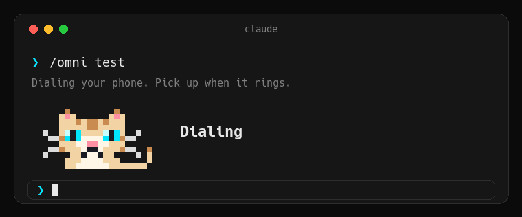
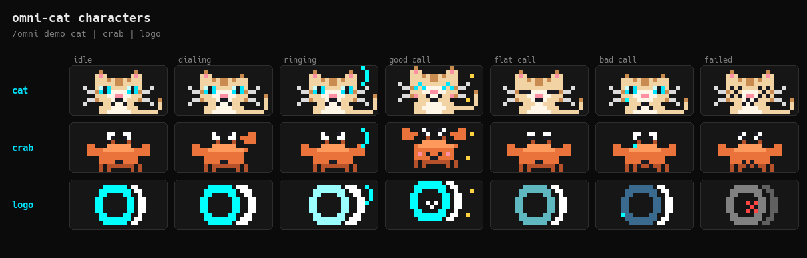

<p align="center">
  
</p>

# omni-cat

A pixel cat that lives above your Claude Code prompt. Type `/omni test` and it dials your phone with an [OmniDimension](https://omnidim.io) voice agent, paces while it dials, shakes while it rings, and tells you how the call went.

It is a [Claude Code mod](https://code.claude.com/docs/en/plugins/mods/overview): a plugin that draws in the terminal. It is also a fast way to hear a voice agent you are building, without leaving your editor.

## Try it in a minute

You do not need an account or a key for the demo.

```
claude plugin marketplace add aloki-alok/omni-cat
```

```
claude plugin install omni-cat@omni-cat
```

Restart Claude Code, then run:

```
/omni demo cat
```

The cat dials, rings, and reacts to a good call, a flat one, a bad one, and a failure. Try `/omni demo crab` and `/omni demo logo` too.

## Test a real call

You need an OmniDimension account, an API key, an agent ID, and your own phone number.

1. Run `/plugin configure omni-cat@omni-cat` in Claude Code. Set the API key, the agent ID, your phone number (with country code, like `+15551234567`) and the character.
2. Run `/omni check`. It reads one call log and places no call, so it is a free way to confirm the setup.
3. Run `/omni test`. Your phone rings. Pick up and talk to the agent.

A test call is a real call. It uses credits on the account the key belongs to.

You can also set values from a zsh shell. This keeps the key out of your shell history:

```
read -rs "k?OmniDimension API key: "; printf '{"api_key":"%s"}' "$k" | claude plugin configure omni-cat@omni-cat --values-stdin; unset k
```

## Commands

| Command | What it does |
|---|---|
| `/omni demo [cat\|crab\|logo]` | Plays every state of a character. No key, no call. |
| `/omni check` | Reads one call log to confirm your key and agent work. No call. |
| `/omni test` | Calls your phone with your agent, then reports the result. |
| `/omni last` | Loads the last test call's transcript, so Claude can suggest prompt changes. |
| `/omni clear` | Sends the cat home. |

The cat appears while a demo or a test call runs, and goes home 90 seconds after a call ends. It does not sit there all day.

## Pick your character

<p align="center">
  
</p>

Set the character in `/plugin configure omni-cat@omni-cat`. All three react to the same states: the cat's ears flick while it dials and its tail swishes while the phone rings, and each one celebrates a good call and reacts to a bad one.

## What it sends

- Your API key goes only to `https://omnidim.io/api/v1`, over https. It is stored as a sensitive plugin setting, not in a plain file.
- It makes two kinds of request: start a call (`POST /calls/dispatch`) and read the newest call log for the agent you chose (`GET /calls/logs`).
- It follows a call by watching that log. A call counts as finished only when someone spoke, or when the platform reports why not: no answer, busy, failed, or voicemail.
- No analytics, no telemetry, nothing else leaves your machine.

## Requirements

- Claude Code 2.1.287 or later, running in a terminal with true color, such as iTerm2, Ghostty, kitty or WezTerm. Other terminals may show approximate colors.
- The Claude desktop app and the VS Code panel do not show the cat, because the mod draws with the terminal's pixel element.

## How it works

The cat is drawn from code, not from image files. Each character is a small grid of colored pixels, packed two pixels to a terminal cell and painted with Claude Code's terminal `Raster` element in 24-bit color. Every frame of the GIF above comes from that same drawing function.

## Status

Today the cat reports a call from its call log, which covers how it ended. Live stages while the call is in progress, and live conversation text, are planned.

## Development

```
claude plugin test .
claude plugin validate .
```

To re-render the images in `docs/assets` (needs [bun](https://bun.sh), [uv](https://docs.astral.sh/uv/) and a monospace font; Hack Nerd Font is used if installed):

```
bun tools/dump-frames.ts > /tmp/frames.json
uv run --with pillow python tools/compose.py /tmp/frames.json docs/assets
```

`docs/assets/social-preview.png` is the 1280 by 640 card for the repository's social preview.

## License

MIT. See [LICENSE](LICENSE).
